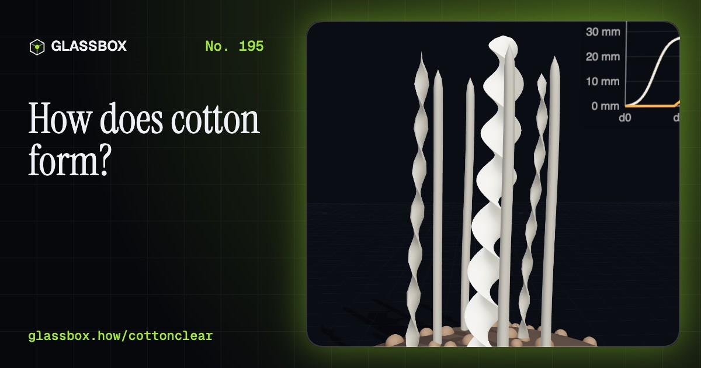
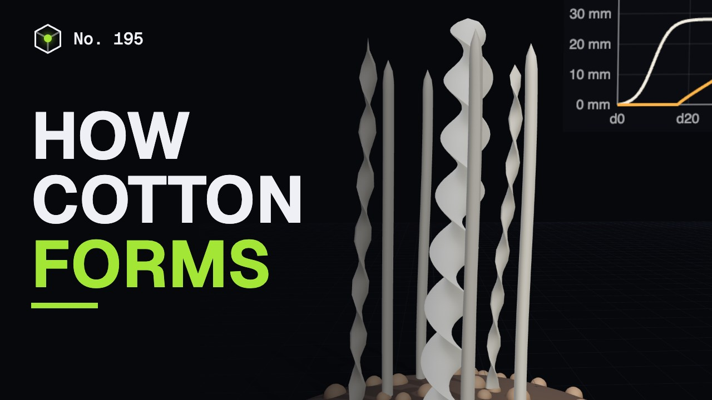
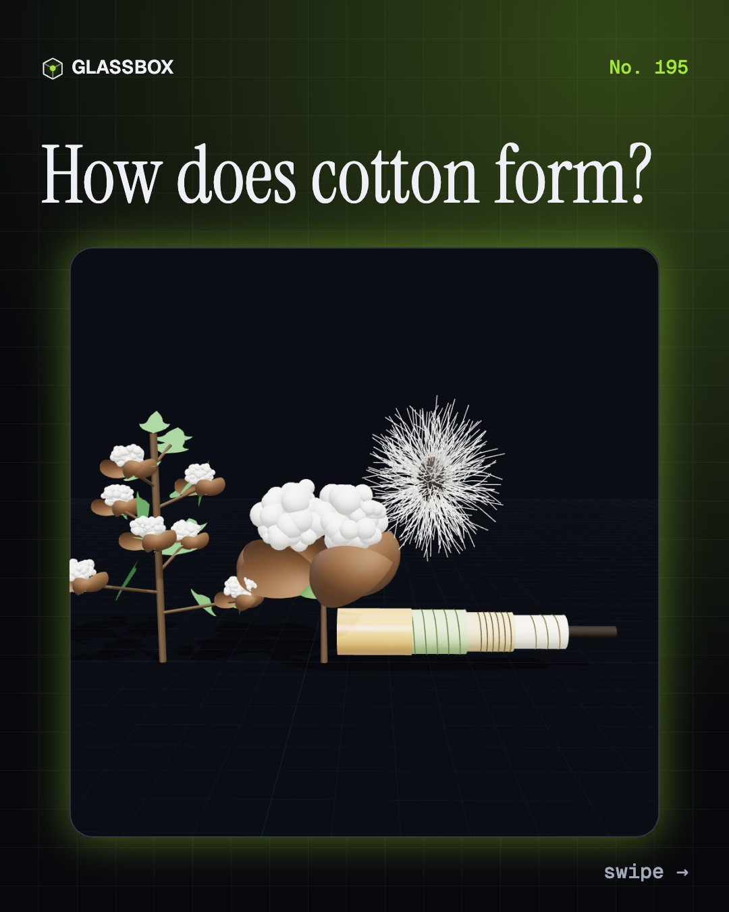
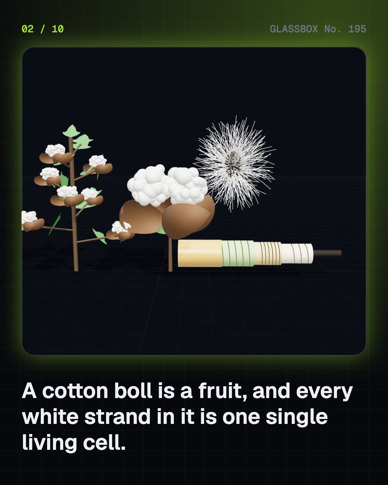
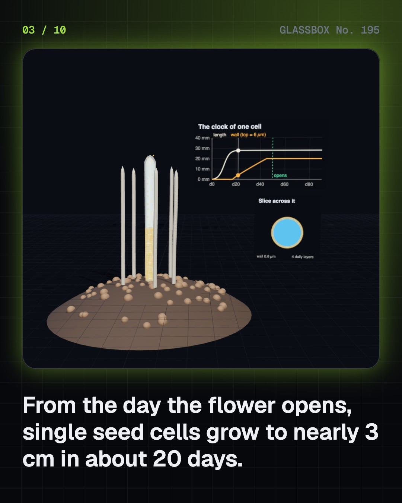
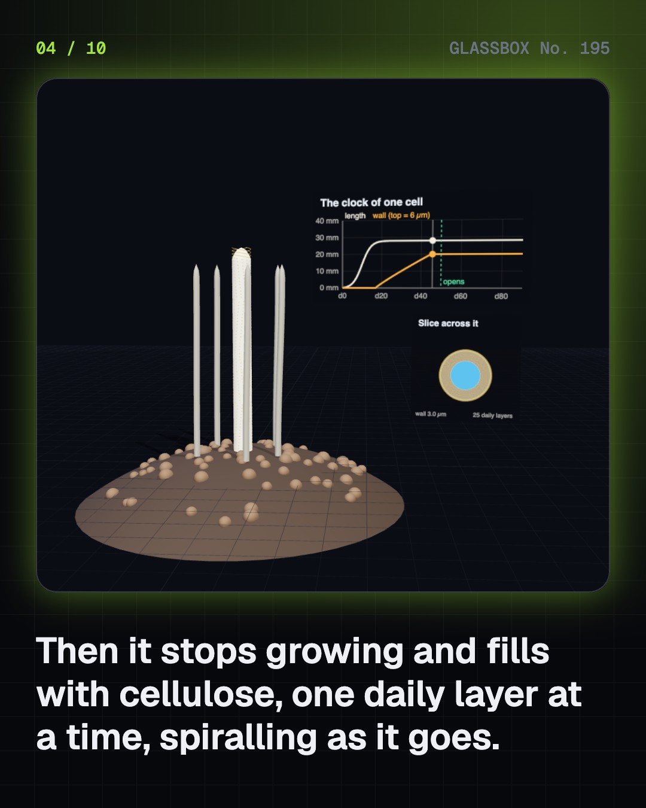

<!-- glassbox:start -->
<!-- Generated from glassbox.json by the Glassbox hub (npm run readme -- cottonclear). Edit glassbox.json, not this block. -->
<p align="center"><a href="https://glassbox.how/e/cottonclear/"></a></p>

<h1 align="center">CottonClear</h1>

<p align="center"><b>How does cotton form?</b><br>Every white strand in a cotton boll is one single cell, grown nearly 3 cm long in twenty days, then filled with cellulose, dried and twisted. Grow one yourself, spin it into thread, and follow the fibre from Mehrgarh through empire, slavery and Gandhi's charkha to Bt cotton.</p>

<p align="center"><a href="https://glassbox.how/cottonclear/"><b>▶ Play with it</b></a> &nbsp;·&nbsp; <a href="https://glassbox.how/e/cottonclear/">Read the 60-second explainer</a> &nbsp;·&nbsp; <a href="https://glassbox.how/cottonclear/glassbox/reel.mp4">Watch the 40-second video</a></p>

<p align="center">
  <a href="https://glassbox.how/e/cottonclear/"></a>
  <a href="https://glassbox.how/e/cottonclear/"></a>
  <a href="LICENSE"></a>
  <a href="LICENSE-CONTENT.md"></a>
  <a href="#privacy"></a>
</p>

## In 60 seconds

1. **A seed hair, one cell long.** Cotton is a shrub whose fruit, the boll, holds about 30 seeds. Each seed wears long lint and short fuzz. Every hair is a single giant cell: a waxy cuticle, a primary wall, a winding layer, a thick secondary wall of cellulose and a hollow lumen.
2. **One cell, 3 cm long.** From the day the flower opens, a seed-skin cell grows for about 20 days to 25 to 30 mm. Then it fills with spiralling cellulose in daily layers. About 50 days after flowering at a mean of 25 °C, the boll opens, the cell dries and the tube collapses into a twisted ribbon.
3. **Why cotton behaves as it does.** Cellulose chains hold on by hydrogen bonds. Water enters the loose parts, so cotton takes up about 8.5% moisture in ordinary air and gets about 10 to 20% stronger wet. Bonds re-forming in bent chains cause creases. Narrow gaps between fibres wick liquid by capillary action.
4. **Twist makes friction make strength.** Gins take off the lint, about a third of seed cotton's weight. Carding and drawing line up the fibres. Spinning adds twist, which squeezes fibres so friction holds them. Longer staple spins finer yarn. In a labelled estimate, one shirt takes the lint of about 180 bolls.
5. **Growing it, fairly.** India has the world's largest cotton area and is second in output, mostly grown on rain. Bt cotton first cut bollworm damage, then the pink bollworm evolved resistance. Researchers disagree on its yield effect. Water figures depend on method. Farmer distress has many causes, and the role of Bt is debated.
6. **A thread through history.** Cotton threads at Mehrgarh date to the 6th millennium BCE. Indian cloth led the world until British bans, Company coercion and Lancashire machines. Whitney's gin fed American slavery, grown to nearly 4 million people by 1860. Gandhi's charkha made spinning a political act.

## Words worth knowing

| Term | Meaning |
|---|---|
| **Boll** | The cotton plant's fruit, a capsule that splits open to show lint and seeds. |
| **Lint and fuzz** | The long seed hairs spun into thread, and the short ones left on the seed after ginning. |
| **Cellulose** | A long chain of glucose units: the stuff of cotton, wood and paper. |
| **Secondary wall** | The thick layers of cellulose a fibre lays down once it stops growing longer. |
| **Convolution** | A natural twist in a dried cotton fibre, which helps fibres grip when spun. |
| **Ginning outturn** | The share of seed cotton's weight that comes out as lint, about 36% on average in India. |
| **Staple** | The typical length of a batch of fibres. Longer staple spins finer yarn. |
| **Yarn count (Ne)** | How many 840-yard hanks weigh one pound. Higher means finer. |
| **Bt cotton** | Cotton given a bacterial gene to make a protein toxic to certain caterpillars. |

## A short history

**Over 7,000 years from threads on a copper bead to a gene in a field, through empire, slavery and freedom.**

- **5500 BCE** · Cotton threads on a copper bead (Neolithic people of Mehrgarh, Mehrgarh, Balochistan)
- **2500 BCE** · Cloth on a silver vessel at Mohenjo-daro (Harappan weavers, Mohenjo-daro, Sindh)
- **1350** · The charkha in Indian writing (Isami, Kannada poets, Deccan and northern India)
- **1757** · The Company takes control of Bengal's weavers (East India Company, Bengal)
- **1794** · Whitney's saw gin (Eli Whitney, on Catherine Greene's plantation in Georgia, Georgia)
- **1800** · Slavery grows on cotton (Enslaved African Americans, American South)
- **1820** · Bengal's fine weaving collapses (Bengal's spinners and weavers, Lancashire exporters, Dhaka and Lancashire)
- **1854** · Bombay's first cotton mill (Cowasji Nanabhoy Davar, Tardeo, Bombay)

The full story, with 25 moments, charts, people and 36 sources: [glassbox.how/e/cottonclear/history](https://glassbox.how/e/cottonclear/history/). The data lives in [`history.json`](history.json).

## Video and slides

Made with the Glassbox studio from this box's storyboard (`window.glassbox.director`). Free to reuse under CC BY 4.0.

<a href="https://glassbox.how/cottonclear/glassbox/video.mp4"></a>

<p><a href="glassbox/slide-1.jpg"></a> <a href="glassbox/slide-2.jpg"></a> <a href="glassbox/slide-3.jpg"></a> <a href="glassbox/slide-4.jpg"></a></p>

| File | What | Size |
|---|---|---|
| [`glassbox/reel.mp4`](https://glassbox.how/cottonclear/glassbox/reel.mp4) | Reel / Short, with captions and soundtrack | 1080×1920 |
| [`glassbox/video.mp4`](https://glassbox.how/cottonclear/glassbox/video.mp4) | YouTube video, with captions and soundtrack | 1920×1080 |
| `glassbox/slide-1…10.jpg` | Instagram carousel | 1080×1350 |
| `glassbox/thumb.jpg` | YouTube thumbnail | 1280×720 |
| `glassbox/cover.jpg` | Share card and repo social preview | 1200×630 |
| [`glassbox/history-reel.mp4`](https://glassbox.how/cottonclear/glassbox/history-reel.mp4) | “History in 10 moments” Reel / Short | 1080×1920 |
| `glassbox/history-slide-*.jpg` | History carousel | 1080×1350 |
| `glassbox/post.json` | Post copy and schedule used by the publish kit | |

## Privacy

This box has no accounts and no ads, and it ships its own fonts and libraries. When you run it yourself it sends nothing anywhere. On glassbox.how, the site's `/bar.js` also loads Glassbox's analytics: **Google Analytics** to count visits (it asks first in the EU, UK and Switzerland, and stays off when your browser sends Global Privacy Control or Do Not Track) and **ClickTrust** to detect bots.

It remembers a few things **in your own browser only**, and never sends them anywhere:

| Browser storage key | What it holds |
|---|---|
| `cottonclear.v1` | Which chapters you have opened, your best quiz scores, and sound on or off. |

Exactly what each one sees is at [glassbox.how/privacy](https://glassbox.how/privacy/).

## Licences

- **Code:** [MIT](LICENSE). Use it, change it, ship it.
- **Explanations, text, images and videos** (`glassbox.json`, `glassbox/`): [CC BY 4.0](LICENSE-CONTENT.md). Credit “Glassbox, glassbox.how/e/cottonclear”.
- **Third-party parts** keep their own licences: [three.js](https://threejs.org) (MIT), [Geist, Instrument Serif](https://openfontlicense.org) (SIL OFL 1.1).
- The Glassbox name and logo aren't covered by either licence. See the [terms](https://glassbox.how/terms/).

Found a mistake? [Open an issue](https://github.com/bdeeps/cottonclear/issues). Corrections happen in public.
<!-- glassbox:end -->

## Run it

It's plain HTML, CSS and JavaScript. No build step and no dependencies. Run locally, it contacts no other website.

```bash
python3 -m http.server 8000
```

Three.js and the fonts ship in `vendor/` and `fonts/`, so it also works offline.

Then open http://localhost:8000.

## How it's built

| File | What |
|---|---|
| `index.html`, `css/app.css` | The page and its styles |
| `js/app.js`, `js/stage.js`, `js/ui.js`, `js/kit.js` | The shared Glassbox 3D engine: chapters, 3D stage, controls, quiz, video director |
| `js/chapters/*.js` | One file per chapter: the 3D model, controls, text, key terms, quiz and video scenes |
| `js/cotton.js` | Cotton models (cell growth, spinning, raw cotton per garment, resistance, sorption), official figures, plant and fibre parts |
| `glassbox.json` | Title, question, explainer beats, key terms, browser storage and credits shown on glassbox.how |
| `reel` in each chapter | The storyboard the Glassbox studio records into short videos |
| `glassbox/` | The published video, slides, thumbnail and post copy |
| `fonts/`, `vendor/three/` | Self-hosted Geist and Instrument Serif (SIL OFL 1.1) and three.js (MIT) |
